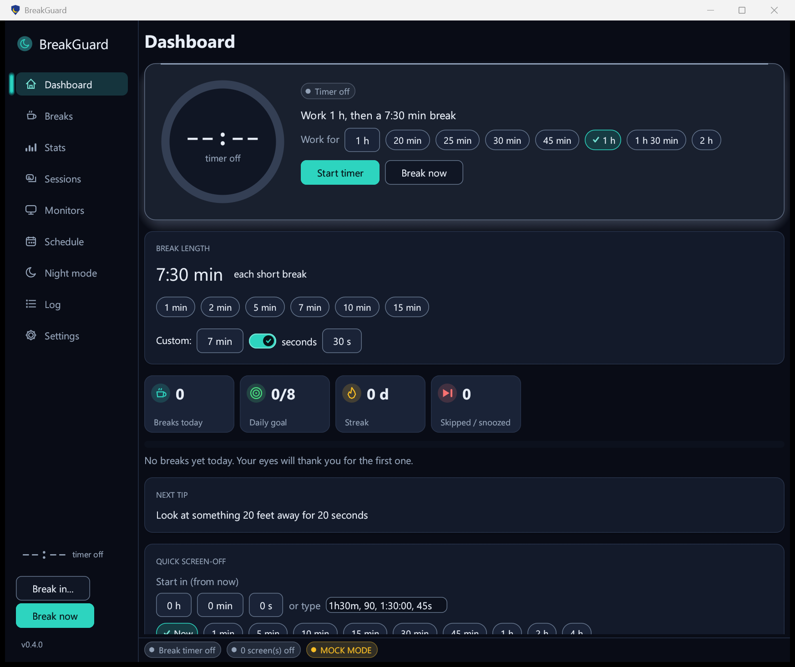
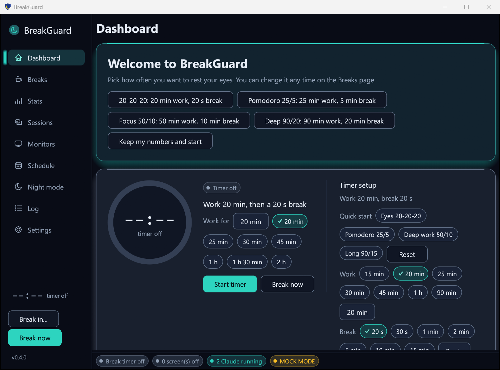
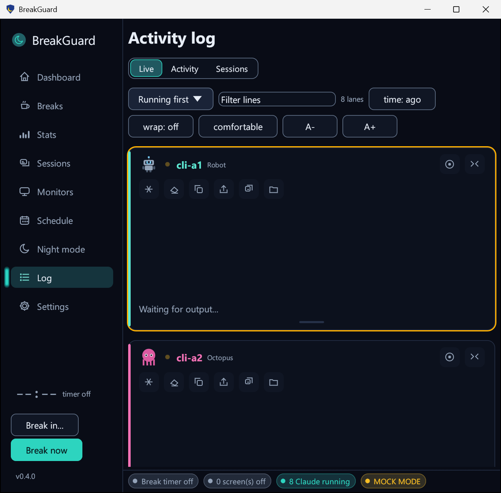
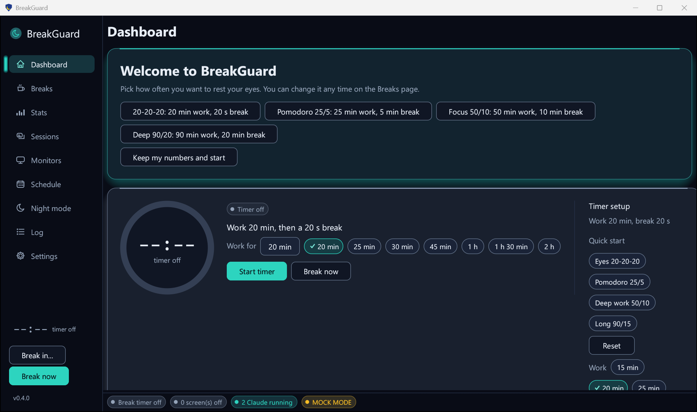

<p align="center"></p>

<p align="center">
  
  
  
  
  
</p>

# BreakGuard

Windows desktop utility that protects your eyes and sleep. It never closes, kills or locks your programs.

<p align="center"></p>

## Features
- **Screen off per monitor** for N minutes. Hardware off via DDC/CI; falls back to a software blackout overlay if the monitor refuses.
- **Break reminders**: work/break timer (20-20-20 style) with warning, skip and snooze.
- **Scheduled screen-off** at a time of day (daily or once).
- **Timed PC sleep** with a wake timer.
- **Night mode**: warm dim overlay in a time window.
- **Activity log**: `breakguard.log` next to the exe (rotates at 256 KB).

## Dashboard Timer setup
The timer card on the **Dashboard** sets up your work/break rhythm in a few clicks:

1. **Work for**: pick a quick chip (15, 20, 25, 30, 45, 60, 90 min) or type your own length (`2:15`, `2h`, `45`).
2. **Break length**: pick a chip (20 s, 30 s, 1, 2, 5, 10, 15 min) or use *Custom* with the seconds switch for exact lengths such as `7:30`.
3. **Warn me**: choose no warning or a heads-up of 10 s, 30 s or 1 min before the break.
4. **Presets**: one click sets a pair, for example **Long** = 90 min work / 15 min break.
5. A live summary line confirms the choice (`Work 1 h, break 1 min 35 s`). **Start timer** begins; **Break now** starts a break at once.
6. **Reset to defaults** restores the standard setup (safe to press twice).

Optional break actions (such as dimming the screen) toggle on and off; toggling twice leaves nothing saved.

<p align="center"></p>

## Safety guarantees
- Programs are never closed, killed or locked. Sleep only suspends the PC.
- Hardware off arms a detached failsafe helper FIRST; it turns the monitor back on at the deadline (retries + mouse nudge).
- Blackout overlay always ends at its deadline; Esc or 3 quick clicks exits early.
- The GUI restores every monitor it turned off before quitting.
- Single instance (named mutex).

## Run
`breakguard.exe` (or `start-breakguard.bat`) opens the GUI.

## CLI
| Command | Meaning |
|---|---|
| `breakguard` | GUI |
| `breakguard blackout --monitor <dev\|all> --secs N [--alpha 0-255] [--tint R,G,B]` | software blackout overlay |
| `breakguard helper-on --monitor <dev> --at <unix_secs>` | failsafe: turn monitor on at time |
| `breakguard selftest` | engine+sys checks, prints `SELFTEST OK` |
| `breakguard --version` | version |

## Settings and data
`%APPDATA%\BreakGuard\settings.ini` (key=value, atomic write, tolerates corruption). Override the folder with `BREAKGUARD_DATA_DIR`.

## Mock mode (safe testing)
Set both variables before running; no real monitor, display or sleep call is made. Fake monitors `\\.\DISPLAYMOCK1` (primary, 1920x1080) and `\\.\DISPLAYMOCK2`; every call appends a line to the mock file.

```powershell
$env:BREAKGUARD_DDC_MOCK="$env:TEMP\bg-mock.log"
$env:BREAKGUARD_DATA_DIR="$env:TEMP\bg-data"
.\breakguard.exe selftest
```

## Install
Download or build `breakguard.exe`, put it anywhere and run it. No installer, no admin rights. Settings live in `%APPDATA%\BreakGuard`.

## Build
Needs Rust (stable) on Windows: `cargo build --release`, or use the script below.

`scripts\build.ps1` makes a clean release build (offline, no extra crates) in `F:\bgbuild\release` and stages the exe. Icon, manifest (PerMonitorV2 DPI, UTF-8) and version info are embedded with `windres` when it is on PATH.

## Health check

`pwsh scripts\check-all.ps1` builds, runs clippy, `cargo test`, `scripts\qa.ps1`, `scripts\idle-cpu.ps1`
and verifies the installed exe (`--version`, `selftest`). It runs only in mock mode (temp data dir) and
prints `ALL OK`. Add `-SkipInstalled` to skip the installed-exe checks.

## Troubleshooting DDC/CI
- Enable "DDC/CI" in the monitor's on-screen menu.
- Use a direct cable (DisplayPort/HDMI/DVI); some docks and adapters block DDC.
- If the monitor does not answer, BreakGuard falls back to the software blackout and logs it.
- Some monitors stay on standby after hardware off and wake slowly; the helper retries up to 5 times.
- Check `breakguard.log` for lines like `hardware off ... off command accepted, helper armed` and `turn on (timer) ...`.

## 0.4.0 additions
Sessions page (live Claude Code sessions, refreshed every second off the UI thread), global hotkeys Ctrl+Alt+letter (Settings > Hotkeys), tray icon with menu, start minimized and close to tray.

## Screenshots
| Sessions | Dashboard (wide) |
|---|---|
|  |  |
